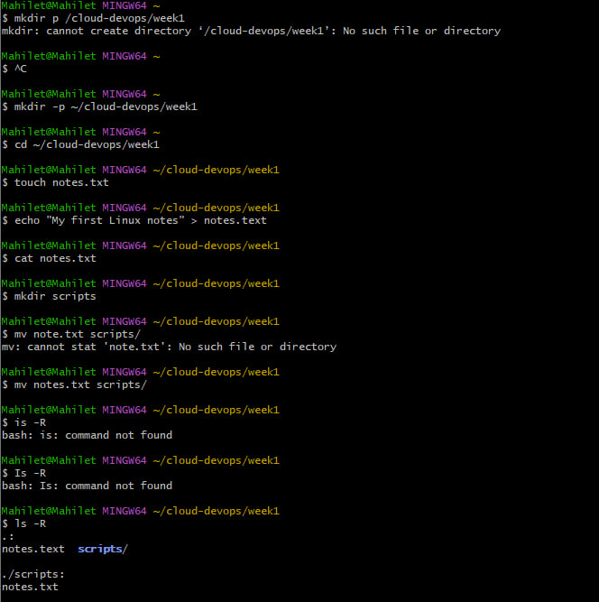
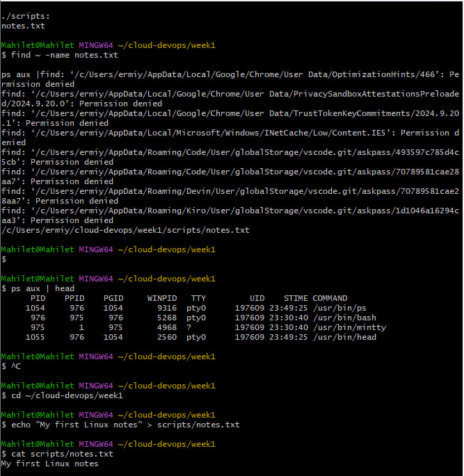
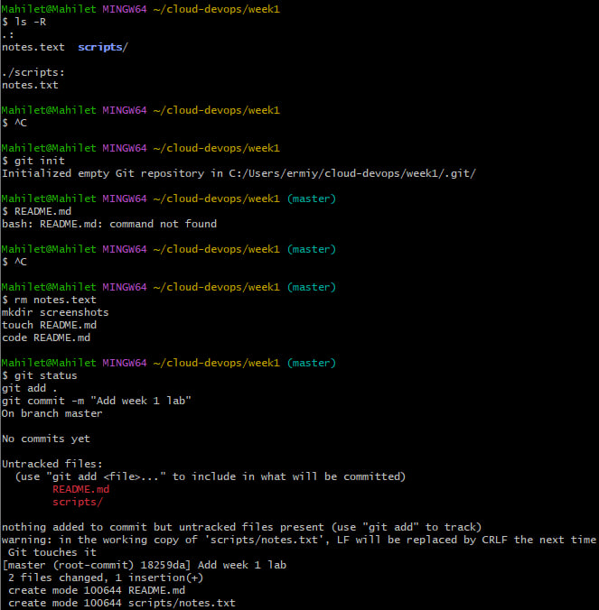
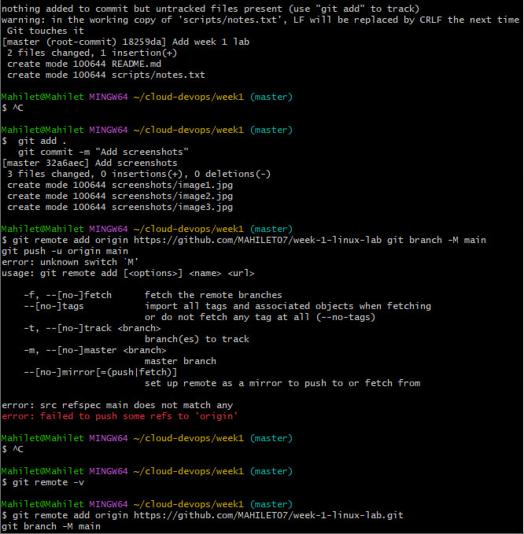
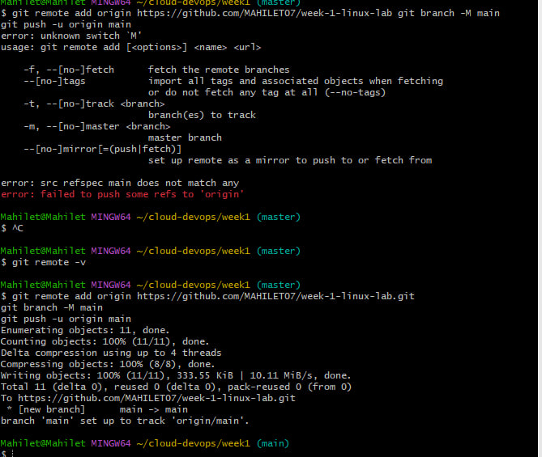

# Week 1 Linux Lab: My First Project Workspace

Name: Mahilet Andualem

## Tasks and commands

1. Create the directory: `mkdir -p ~/cloud-devops/week1`
2. Create notes.txt: `touch notes.txt`
3. Add text to notes.txt: `echo "My first Linux notes" > notes.txt`
4. Create scripts directory: `mkdir scripts`
5. Move the file: `mv notes.txt scripts/`
6. Search for the file: `find ~ -name notes.txt`
7. Find a process and its PID: `ps aux | head` (example: PID 976, /usr/bin/bash)

## Screenshots

